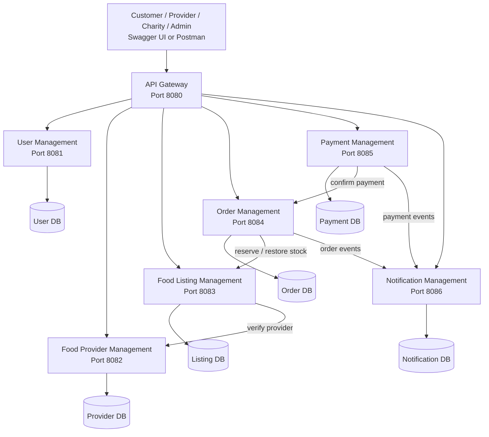

# RescueBite

### A microservices platform for reducing food waste and making surplus food accessible

RescueBite connects food providers with customers and charities so that safe, surplus food can be redistributed instead of discarded. Providers publish time-sensitive food listings, customers reserve discounted items for pickup, and charities can access donation listings. The platform handles provider verification, inventory, orders, payments, collection codes, and notifications.

## Why RescueBite?

Restaurants, bakeries, supermarkets, and cafés frequently have edible food left at the end of the day. Without a fast way to advertise and manage that surplus, it is often wasted. RescueBite gives providers a practical way to publish available food before expiry while helping customers find affordable meals and charities source food donations.

## Key capabilities

- Secure user registration and login with JWT authentication
- Role-based accounts for customers, providers, charities, and administrators
- Food-provider business registration and verification
- Surplus food listings with quantity, pricing, expiry, and collection deadlines
- Free donation listings for charitable collection
- Atomic stock reservation and restoration
- Order lifecycle management and unique collection codes
- Simulated payment processing, refunds, and payment status tracking
- User notifications with unread-count and read-status support
- Interactive API documentation through Swagger UI

## Architecture

RescueBite uses six independent Spring Boot microservices. Each service owns its own MongoDB database and exposes a REST API. An optional API Gateway provides a single entry point for client requests.



## Services

| Service | Port | Database | Responsibility |
|---|---:|---|---|
| API Gateway | 8080 | — | Routes client requests to the correct service. |
| User Management | 8081 | `rescuebite_user_db` | Authentication, JWT tokens, roles, and profiles. |
| Food Provider Management | 8082 | `rescuebite_provider_db` | Provider profiles and verification. |
| Food Listing Management | 8083 | `rescuebite_listing_db` | Surplus and donation listings, quantities, prices, and expiry details. |
| Order Management | 8084 | `rescuebite_order_db` | Reservations, order status, cancellations, and collection codes. |
| Payment Management | 8085 | `rescuebite_payment_db` | Simulated payments, payment history, and refunds. |
| Notification Management | 8086 | `rescuebite_notification_db` | Notifications, unread count, and read-status management. |

## Order journey

1. A user creates an account and signs in.
2. A food provider creates a business profile and is verified.
3. The provider publishes a discounted surplus listing or donation listing.
4. A customer reserves food; the system reserves stock and creates a collection code.
5. The customer completes a simulated payment; a successful payment confirms the order.
6. The provider verifies the collection code at pickup and marks the order as collected.
7. Notifications keep users updated throughout the journey.

> The current version supports pickup and collection-code verification. Dedicated delivery assignment and live delivery tracking are planned future enhancements.

## Technology stack

- Java 17
- Spring Boot 3.2.5
- Spring Web, Spring Data MongoDB, Spring Security, JWT, Spring Cloud Gateway
- MongoDB 6
- Maven 3.10.x
- Docker Compose
- Swagger / OpenAPI and Postman

## Getting started

### Prerequisites

- Java JDK 17
- Apache Maven **3.10.x**
- Docker Desktop

Verify the required tools:

```powershell
java -version
mvn -version
docker --version
```

### Start MongoDB

From the project root, start Docker Desktop and run:

```powershell
docker compose up -d
docker ps
```

The `rescuebite-mongodb` container should be running on port `27017`.

### Start a service

Run a service from its directory. For example, start User Management:

```powershell
cd user-service
mvn spring-boot:run
```

The application is ready when the terminal displays `Started UserApplication`.

### Start all services

After Maven is available from your PATH, run this once from the project root:

```powershell
powershell -ExecutionPolicy Bypass -File .\start-services.ps1
```

## API documentation

| Service | Swagger UI |
|---|---|
| User Management | http://localhost:8081/swagger-ui/index.html |
| Food Provider Management | http://localhost:8082/swagger-ui/index.html |
| Food Listing Management | http://localhost:8083/swagger-ui/index.html |
| Order Management | http://localhost:8084/swagger-ui/index.html |
| Payment Management | http://localhost:8085/swagger-ui/index.html |
| Notification Management | http://localhost:8086/swagger-ui/index.html |

## Testing

The repository includes a ready-to-use [Postman collection](./RescueBite_Postman_Collection.json).

Suggested end-to-end test order:

1. Register a customer and a provider user.
2. Create a provider profile and verify it.
3. Create a food listing.
4. Place an order and note the collection code.
5. Process a successful payment.
6. Collect the order using the collection code.
7. Check the user’s notifications.

To run unit tests and verify the build:

```powershell
mvn test
mvn clean verify
```

## Project structure

```text
RescueBite/
├── api-gateway/
├── user-service/
├── food-provider-service/
├── food-listing-service/
├── order-service/
├── payment-service/
├── notification-service/
├── docker-compose.yml
├── RescueBite_Postman_Collection.json
└── start-services.ps1
```


