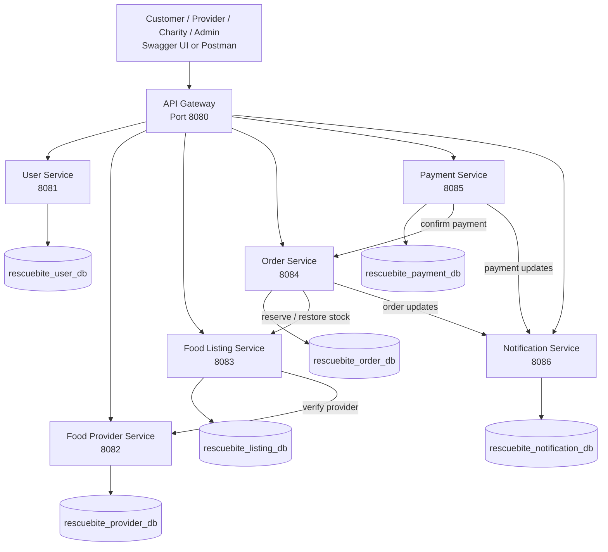

# RescueBite – Food Waste Management and Redistribution Platform

> **ITS4243 – Microservices and Cloud Computing | Assignment 01**  
> **Stage:** Local testing and team handoff

RescueBite is a food-waste reduction platform for restaurants, bakeries, supermarkets, and cafés. Verified providers publish safe surplus food before it expires; customers can reserve discounted food for pickup, and charities can find eligible donation listings. The platform manages users, providers, listings, stock, orders, payments, collection codes, and notifications.

## 1. Domain name

**Food waste management and food redistribution.** The domain reduces avoidable food waste from commercial providers while improving access to affordable food and charitable donations.

## 2. Project title

**RescueBite – Food Waste Management and Redistribution Platform**

## 3. Problem statement

Commercial food providers frequently discard edible surplus food because there is no fast, dependable way to advertise it, control available quantity, and arrange collection before expiry. Meanwhile, customers seek affordable food and charities need donation opportunities. RescueBite connects these groups through a verified, time-sensitive marketplace with ordering, payment, collection, and notification support.

## 4. Target users

| Actor | Main use |
|---|---|
| Customer | Registers, finds surplus food, places orders, pays, and collects food. |
| Food provider | Creates a business profile and publishes surplus or donation listings. |
| Charity | Uses available donation listings for charitable collection. |
| Administrator | Verifies providers and manages user access. |
| Provider collection staff | Validates a collection code and completes handover. |

## 5. Five business scenarios

### 5.1 User registration and login

**Actors:** Customer, provider, charity, administrator.  
**Process:** A user registers with a role, logs in, and receives a JWT token for protected endpoints.  
**Business value:** Establishes authenticated, role-aware access.

### 5.2 Provider onboarding and verification

**Actors:** Food provider, administrator.  
**Process:** A provider submits business details; an administrator verifies or rejects the profile.  
**Business value:** Only approved businesses can publish food, improving trust and accountability.

### 5.3 Surplus food and donation publishing

**Actors:** Verified provider, customer, charity.  
**Process:** A provider creates a listing with quantity, price, expiry date, collection deadline, and pickup address. A listing may be discounted or a zero-price donation.  
**Business value:** Makes safe food discoverable before it becomes waste.

### 5.4 Reservation, payment, and collection

**Actors:** Customer, provider, collection staff.  
**Process:** A customer reserves a listing; stock is reserved and a collection code is generated. The customer makes a simulated payment. At pickup, the provider verifies the code and marks the order collected.  
**Business value:** Prevents overselling and creates an auditable food-collection workflow.

### 5.5 Notifications for order and payment events

**Actors:** Customer, provider, charity.  
**Process:** The system creates notifications for order creation, payment confirmation, collection updates, and donation-related activity.  
**Business value:** Keeps participants informed and reduces missed collections.

## 6. Implemented microservices and team allocation

| Team member | Microservice | Port | MongoDB database | Key responsibility |
|---|---|---:|---|---|
| Member 1 | User Management | 8081 | `rescuebite_user_db` | Registration, login, BCrypt passwords, JWT, roles, profiles. |
| Member 1 | Food Provider Management | 8082 | `rescuebite_provider_db` | Provider profiles and verification. |
| Member 3 | Food Listing Management | 8083 | `rescuebite_listing_db` | Surplus/donation listings and stock operations. |
| Member 2 | Order Management | 8084 | `rescuebite_order_db` | Reservations, statuses, collection codes, cancellation. |
| Member 2 | Payment Management | 8085 | `rescuebite_payment_db` | Simulated payments, records, refunds, order confirmation. |
| Member 3 | Notification Management | 8086 | `rescuebite_notification_db` | Notifications, unread count, read status. |

**Scope clarification:** The original proposal grouped delivery with notifications. The current code implements **pickup/collection** with collection codes and notifications. A dedicated delivery-assignment or live-tracking feature is future scope.

## 7. Architecture diagram



Each service owns a separate MongoDB database and communicates through REST. The API Gateway is optional for local testing; it routes `/api/...` traffic to services. MongoDB is one local container in development, but every service has a separate database name.

## 8. End-to-end workflow

1. A customer, provider, charity, or administrator registers and logs in through User Management.
2. A provider creates a business profile; an administrator verifies it.
3. The verified provider publishes a paid surplus listing or donation listing.
4. A customer reserves food; Order Management reserves stock, creates a collection code, and sends notifications.
5. Payment Management records a simulated payment, confirms a successful order, and sends a notification.
6. The provider validates the collection code and the order becomes `COLLECTED`.

## 9. Technology stack

- Java 17, Spring Boot 3.2.5, Maven
- Spring Web, Spring Data MongoDB, Spring Security, JWT, Spring Cloud Gateway
- MongoDB 6 with Docker Compose
- Swagger / OpenAPI and Postman

## 10. API documentation

| Service | Swagger UI |
|---|---|
| User Service | http://localhost:8081/swagger-ui/index.html |
| Food Provider Service | http://localhost:8082/swagger-ui/index.html |
| Food Listing Service | http://localhost:8083/swagger-ui/index.html |
| Order Service | http://localhost:8084/swagger-ui/index.html |
| Payment Service | http://localhost:8085/swagger-ui/index.html |
| Notification Service | http://localhost:8086/swagger-ui/index.html |
| API Gateway health check | http://localhost:8080/actuator/health |

## 11. Setup and run locally

### Prerequisites

1. Java JDK 17
2. Apache Maven **3.10.x** (use the stable Maven 3 release; do not use Maven 4 release candidates for this project)
3. Docker Desktop
4. VS Code with **Extension Pack for Java** (recommended)

Verify installation:

```powershell
java -version
mvn -version
docker --version
```

If `mvn -version` reports a Maven 4 release candidate, download the stable **Maven 3.10.x Binary zip archive** from [Apache Maven](https://maven.apache.org/download.cgi), extract it, and add its `bin` directory to PATH before testing.

Start Docker Desktop, then start MongoDB from the project root:

```powershell
docker compose up -d
docker ps
```

`rescuebite-mongodb` must show as `Up` on port `27017`.

Run one service in the VS Code terminal, for example:

```powershell
cd user-service
mvn spring-boot:run
```

The service is ready when `Started UserApplication` appears. If Maven is not on the Windows PATH, run it by full path:

```powershell
& "C:\path\to\apache-maven\bin\mvn.cmd" -f ".\user-service\pom.xml" spring-boot:run
```

To run all six services after `mvn -version` works:

```powershell
powershell -ExecutionPolicy Bypass -File .\start-services.ps1
```

Run that launcher once only; it opens six windows and each must remain open.

## 12. Testing

### Swagger smoke test

1. Start MongoDB and the User Service.
2. Open `http://localhost:8081/swagger-ui/index.html`.
3. Use `POST /api/auth/register`, **Try it out**, and submit:

```json
{
  "name": "Alice Perera",
  "email": "alice@rescuebite.test",
  "password": "Password123!",
  "phone": "+94771234567",
  "role": "CUSTOMER",
  "address": "10 Galle Road, Colombo 03"
}
```

4. A `201` response confirms registration works.
5. Use `POST /api/auth/login` with the same email and password. Copy the returned JWT for protected User Service endpoints.

### Full integration test order

Import [RescueBite_Postman_Collection.json](./RescueBite_Postman_Collection.json) into Postman, then run requests in this order:

1. Register a customer and provider user.
2. Create and verify a provider profile.
3. Create a paid food listing or donation listing.
4. Place an order; record its ID and collection code.
5. Process a successful payment.
6. Collect the order using the collection code.
7. Check the customer notifications and unread count.

### Build and unit-test verification

From the project root run:

```powershell
mvn test
mvn clean verify
```

Expected outcome: `BUILD SUCCESS`.

## 13. Git workflow and commit steps

This extracted folder is not currently a Git repository. Create a GitHub repository first, then from the project root run:

```powershell
git init
git branch -M main
git add .
git commit -m "Initial RescueBite microservices implementation"
git remote add origin https://github.com/<team-name>/<repository-name>.git
git push -u origin main
```

Each team member should work on a branch:

```powershell
git checkout -b feature/member-1-user-provider
# make changes and test them first
git status
git add user-service food-provider-service README.md
git commit -m "feat: complete user and provider services"
git push -u origin feature/member-1-user-provider
```

Before every commit: run relevant tests, review `git status`, and do not commit secrets, `.env` files, or generated `target/` folders.

## 14. Prompt for a polished architecture diagram

> Create a clean, professional 16:9 landscape microservices architecture diagram for a university project called **RescueBite – Food Waste Management and Redistribution Platform**. Use a white background, blue and green palette, labelled rounded rectangles, clear arrows, and an academic presentation style. Put **Customer, Food Provider, Charity, Administrator, Swagger UI / Postman** at the top. Route them through **API Gateway (Port 8080)**. Below it show: **User Management (8081)**, **Food Provider Management (8082)**, **Food Listing Management (8083)**, **Order Management (8084)**, **Payment Management (8085)**, and **Notification Management (8086)**. Connect each service to its own MongoDB database: `rescuebite_user_db`, `rescuebite_provider_db`, `rescuebite_listing_db`, `rescuebite_order_db`, `rescuebite_payment_db`, `rescuebite_notification_db`. Label REST calls: Food Listing → Food Provider “verify provider”; Order → Food Listing “reserve / restore stock”; Order → Notification “order updates”; Payment → Order “confirm payment”; Payment → Notification “payment updates”. Add the note: “Pickup/collection code workflow; dedicated delivery tracking is future scope.” Do not add decorative illustrations.

## Project structure

```text
RescueBite/
├── api-gateway/
├── user-service/
├── food-provider-service/
├── food-listing-service/
├── order-service/
├── payment-service/
├── notification-service/
├── docker-compose.yml
├── RescueBite_Postman_Collection.json
└── start-services.ps1
```
